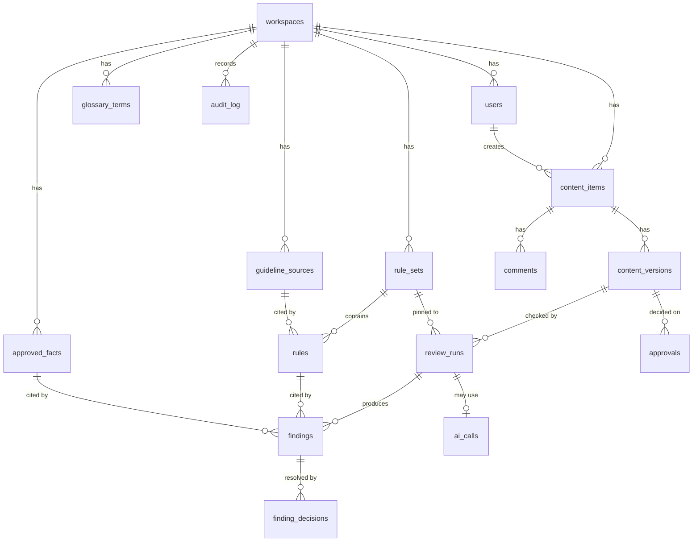

# Database — PostgreSQL 16

Conventions: `uuid` primary keys (`gen_random_uuid()`), `timestamptz` in UTC, `snake_case`, soft-delete **not** used (append-only evidence instead). Round 2 uses a single workspace, but every owned table carries `workspace_id` so multi-brand support (Round 3 option) needs no schema rewrite.

## 1. ER diagram


## 2. Tables

### workspaces
| col | type | notes |
|---|---|---|
| id | uuid PK | |
| name | text NOT NULL | e.g. "Brightway Solar (demo)" |
| confidential_terms | text[] DEFAULT '{}' | always redacted before AI calls |
| created_at | timestamptz | |

### users
| col | type | notes |
|---|---|---|
| id | uuid PK | |
| workspace_id | uuid FK | |
| email | citext UNIQUE NOT NULL | |
| display_name | text NOT NULL | |
| password_hash | text | argon2id; NULL for demo-only accounts |
| role | text CHECK (role IN ('creator','reviewer','manager')) | |
| is_demo | boolean DEFAULT false | |
| created_at | timestamptz | |

### guideline_sources
Documents the rules come from (the thing we cite).
| col | type | notes |
|---|---|---|
| id | uuid PK | |
| workspace_id | uuid FK | |
| title | text NOT NULL | "Brand Voice Guide" |
| version_label | text | "v4" |
| kind | text CHECK (kind IN ('guideline','terminology','fact_sheet','asset_policy')) | |
| body_markdown | text | searchable text of the document |
| uploaded_by | uuid FK users | |
| created_at | timestamptz | |

### rule_sets
| col | type | notes |
|---|---|---|
| id | uuid PK | |
| workspace_id | uuid FK | |
| version | int NOT NULL | UNIQUE (workspace_id, version) |
| status | text CHECK (status IN ('draft','active','archived')) | exactly one `active` per workspace (partial unique index) |
| notes | text | change summary |
| created_by | uuid FK users | |
| created_at, activated_at | timestamptz | |

### rules
| col | type | notes |
|---|---|---|
| id | uuid PK | row is specific to a rule set → exact-version citation |
| rule_set_id | uuid FK | |
| key | text NOT NULL | stable human ID e.g. `CLAIM-001`; UNIQUE (rule_set_id, key) |
| category | text CHECK (category IN ('tone','terminology','messaging','claim','fact','accessibility','visual','confidentiality')) | |
| severity | text CHECK (severity IN ('blocker','major','minor','info')) | |
| title | text NOT NULL | |
| definition | jsonb NOT NULL | detection config, see §4 |
| explanation | text NOT NULL | shown to users |
| suggestion_hint | text | guides fix wording |
| source_id | uuid FK guideline_sources | |
| source_section | text | "5.2" |
| enabled | boolean DEFAULT true | |

### glossary_terms
| col | type | notes |
|---|---|---|
| id | uuid PK | |
| workspace_id | uuid FK | |
| term | text NOT NULL | the form found in text |
| kind | text CHECK (kind IN ('preferred','banned','discouraged')) | |
| preferred_alternative | text | for banned/discouraged |
| case_sensitive | boolean DEFAULT false | |
| note | text | |
| source_id | uuid FK | |

### approved_facts
| col | type | notes |
|---|---|---|
| id | uuid PK | |
| workspace_id | uuid FK | |
| key | text | `FACT-002` UNIQUE per workspace |
| statement | text NOT NULL | "Average household savings were 18–24% (2025 customer study, n=412)" |
| numeric_values | jsonb | `[{"value":18,"unit":"%"},{"value":24,"unit":"%"}]` for number matching |
| valid_from, valid_until | date | stale detection (Round 3) |
| source_id | uuid FK | |
| search_vector | tsvector | GIN index; generated from statement |

### content_items
| col | type | notes |
|---|---|---|
| id | uuid PK | |
| workspace_id | uuid FK | |
| title | text NOT NULL | |
| content_type | text CHECK (content_type IN ('blog','social','ad','web','press','other')) | |
| status | text CHECK (status IN ('draft','checked','in_review','changes_requested','approved','rejected')) | |
| owner_id | uuid FK users | |
| current_version_id | uuid | FK added after versions table (deferrable) |
| created_at, updated_at | timestamptz | |

### content_versions (append-only)
| col | type | notes |
|---|---|---|
| id | uuid PK | |
| content_item_id | uuid FK | |
| version_no | int | UNIQUE (content_item_id, version_no) |
| text_body | text NOT NULL | extracted/pasted text |
| content_hash | char(64) NOT NULL | SHA-256 of `text_body` |
| source_kind | text | 'paste','txt','md','docx','pdf','image' |
| original_filename | text | |
| original_bytes | bytea | ≤ 10 MB |
| image_alt_text | text | for image items |
| change_note | text | e.g. "Applied suggestion for CLAIM-001" |
| created_by | uuid FK users | |
| created_at | timestamptz | |

### review_runs (append-only)
| col | type | notes |
|---|---|---|
| id | uuid PK | |
| content_version_id | uuid FK | |
| rule_set_id | uuid FK | pinned version |
| status | text CHECK (status IN ('running','complete','rules_only_ai_failed','error')) | |
| ai_provider, ai_model | text | NULL if AI not used |
| started_at, finished_at | timestamptz | |
| counts | jsonb | `{"blocker":1,"major":2,...}` |
| error_detail | text | |

### findings
| col | type | notes |
|---|---|---|
| id | uuid PK | |
| review_run_id | uuid FK | |
| origin | text CHECK (origin IN ('rule','ai')) | |
| category | text | same enum as rules.category |
| severity | text | |
| rule_id | uuid FK rules | NULL only if `fact_id` set |
| fact_id | uuid FK approved_facts | |
| span_start, span_end | int | offsets in `text_body` |
| quote | text NOT NULL | exact substring |
| explanation | text NOT NULL | |
| suggestion | text | proposed replacement for the quote |
| confidence | numeric(3,2) | 1.00 for rule origin |
| status | text CHECK (status IN ('open','fixed','dismissed','overridden')) DEFAULT 'open' | |
| CHECK | `rule_id IS NOT NULL OR fact_id IS NOT NULL` | **grounding enforced in the schema** |

### finding_decisions (append-only)
| col | type | notes |
|---|---|---|
| id | uuid PK | |
| finding_id | uuid FK | |
| decided_by | uuid FK users | |
| decision | text CHECK (decision IN ('fixed','dismissed','overridden','reopened')) | |
| reason | text | required (≥ 10 chars) for dismissed/overridden |
| created_at | timestamptz | |

### comments
| col | type | notes |
|---|---|---|
| id | uuid PK | |
| content_item_id | uuid FK | |
| content_version_id | uuid FK | optional anchor |
| finding_id | uuid FK | optional anchor |
| author_id | uuid FK | |
| body | text NOT NULL | |
| created_at | timestamptz | |

### approvals (append-only)
| col | type | notes |
|---|---|---|
| id | uuid PK | |
| content_version_id | uuid FK | |
| review_run_id | uuid FK | run the decision relied on |
| decision | text CHECK (decision IN ('approved','changes_requested','rejected')) | |
| decided_by | uuid FK users | |
| note | text | |
| content_hash | char(64) | copy of hash at decision time |
| rule_set_id | uuid FK | copy |
| created_at | timestamptz | |

### audit_log (append-only)
| col | type | notes |
|---|---|---|
| id | bigserial PK | |
| workspace_id | uuid | |
| actor_id | uuid | NULL for system |
| action | text NOT NULL | `content.create`, `review.run`, `finding.dismiss`, `approval.approve`, `ruleset.activate` … |
| entity_type, entity_id | text, uuid | |
| content_hash | char(64) | |
| rule_set_id | uuid | |
| detail | jsonb | |
| created_at | timestamptz | |
| prev_hash, row_hash | char(64) | optional tamper-evident chain (P2) |

### ai_calls
| col | type | notes |
|---|---|---|
| id | uuid PK | |
| review_run_id | uuid FK | |
| provider, model | text | |
| input_sha256 | char(64) | hash of the redacted prompt, not the text |
| input_tokens, output_tokens | int | |
| latency_ms | int | |
| status | text | ok / timeout / invalid_output / error |
| raw_output | text | debugging; purge after event |
| created_at | timestamptz | |

## 3. Constraints and indexes
- `UNIQUE (workspace_id) WHERE status='active'` on `rule_sets` (partial unique index).
- Triggers (or app-level checks plus tests) block `UPDATE`/`DELETE` on `content_versions`, `review_runs`, `approvals`, `audit_log`, `finding_decisions`.
- Indexes: `content_items(workspace_id, status)`, `content_versions(content_item_id, version_no DESC)`, `findings(review_run_id, severity)`, `findings(rule_id)`, `audit_log(workspace_id, created_at DESC)`, GIN on `approved_facts.search_vector`.
- Extensions: `citext`, `pgcrypto` (for `gen_random_uuid`). `vector` is **not** enabled in Round 2.

## 4. `rules.definition` JSON shapes
```jsonc
// banned or preferred wording (can be generated from glossary)
{"type":"term","terms":["cheapest","guaranteed savings"],"case_sensitive":false}

// regex
{"type":"regex","pattern":"\\b(best|#1|number one|fastest|only)\\b","flags":"i"}

// numbers/percentages must match an approved fact
{"type":"number_claim","units":["%","years","days"],"fact_tags":["savings","warranty","install"]}

// accessibility
{"type":"accessibility","check":"image_alt_present"}   // R2
{"type":"accessibility","check":"all_caps_run","max_words":4}

// AI-evaluated (hint passed to the analyser, never trusted without validation)
{"type":"llm","prompt_hint":"Voice should be friendly-professional; no pressure tactics.","examples_ok":["…"],"examples_bad":["…"]}
```

## 5. Seed data (fictional brand "Brightway Solar")
Loaded by `backend/app/seed/seed.py`: 1 workspace, 4 users (1 creator, 1 creator-2, 1 reviewer, 1 manager), 3 guideline sources, 1 active rule set (≈ 20 rules), ~25 glossary terms, ~12 approved facts, 5 content items in different states including one fully approved with audit trail (this feeds the public sample report).
**All seed data is invented. No real company data.**

## 6. Migrations
Alembic; one migration per milestone; each is reversible (`downgrade`). Never edit an applied migration — add a new one.

## 7. Backups and privacy
Managed Postgres daily backups. Original uploaded files live in `content_versions.original_bytes`; deleting a content item is a manager-only hard delete for privacy requests (documented exception to append-only; logged in `audit_log`).
